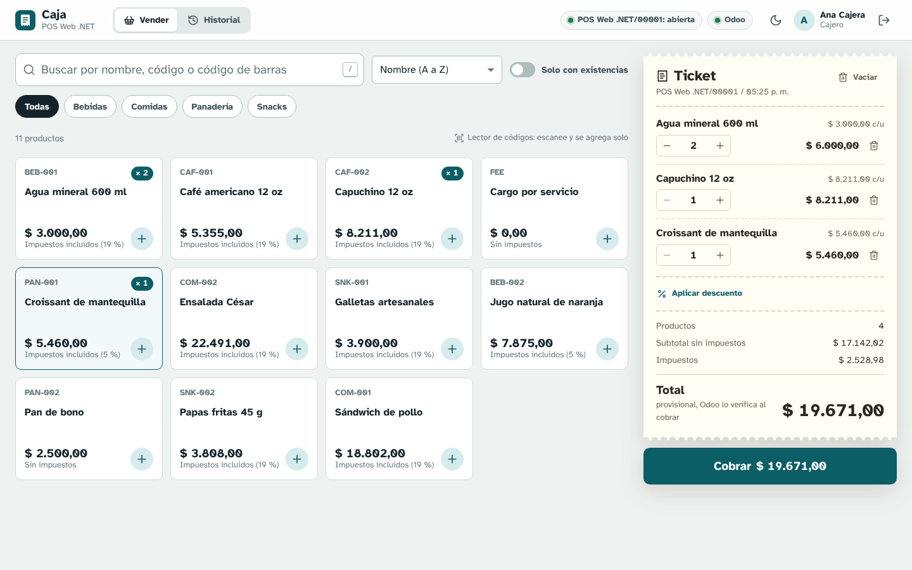
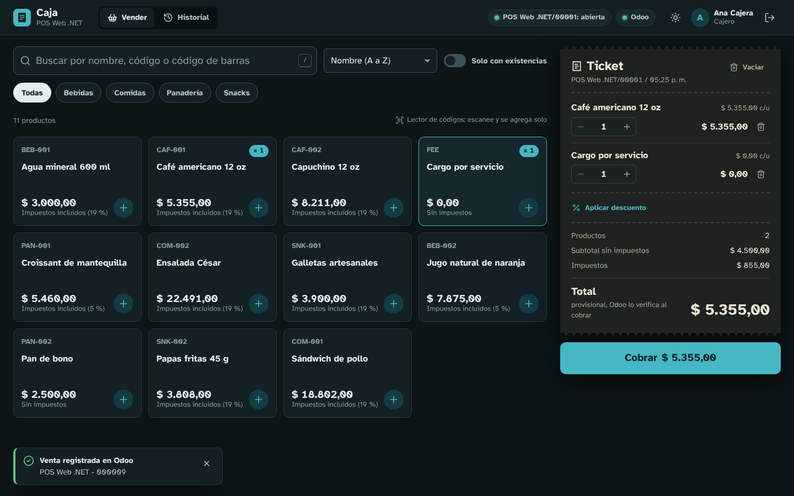
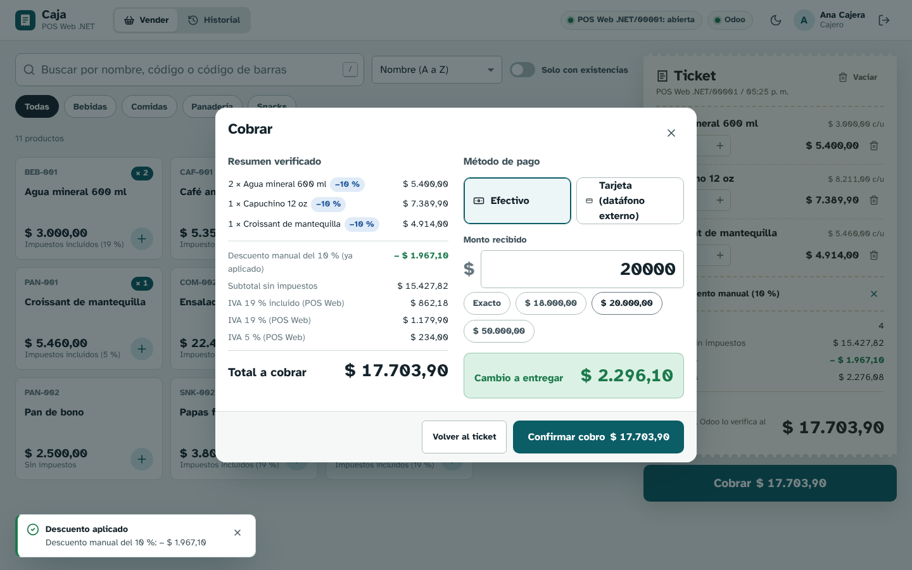
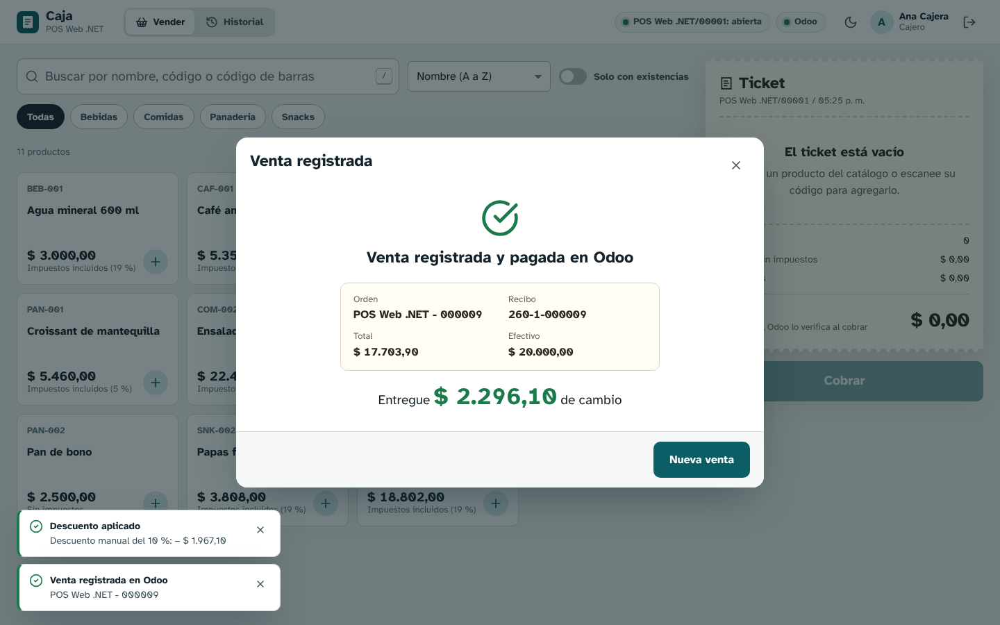
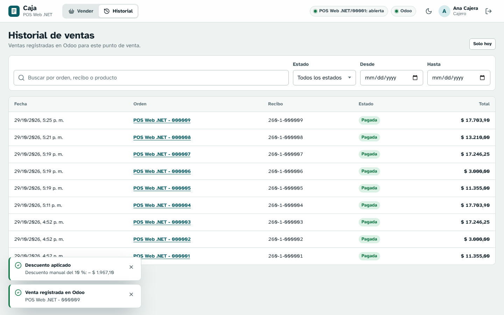
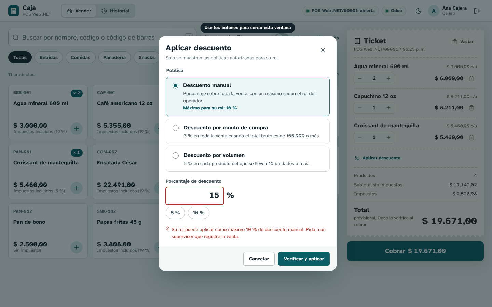
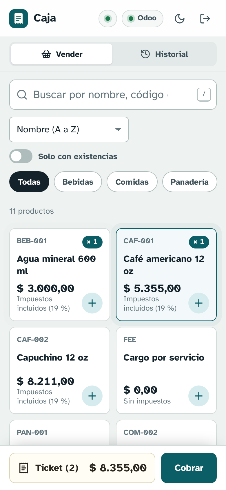

# POS Web integrado con Odoo 20 Community

Proyecto integrador de **Patrones de Software**: un punto de venta web (React + TypeScript) y una API REST en
**ASP.NET Core 10 (C#)**, ambos con **Clean Architecture** (Domain, Application, Infrastructure y Presentation), que registran ventas
y pagos reales en **Odoo 20 Community**. La capa Application del backend usa **CQRS con el patrón Mediator (MediatR)**.

- El navegador nunca habla con Odoo; la API key vive solo en el backend, fuera del repositorio.
- Odoo es la fuente de verdad de productos, precios, impuestos, sesiones, órdenes y pagos.
- Una venta solo se informa como exitosa cuando Odoo la confirma; si no hay certeza, se dice y se puede verificar sin duplicar.



| Tema oscuro | Cobro con verificación de Odoo | Venta registrada |
|---|---|---|
|  |  |  |

| Historial con filtros en vivo | Modal que no se cierra al hacer clic fuera | Móvil |
|---|---|---|
|  |  |  |

## Qué incluye

**Para el cajero**

- Buscador del catálogo que se actualiza mientras se escribe (con espera de 250 ms para no saturar Odoo), filtros por categoría,
  orden, "solo con existencias" y paginación. Atajo `/` para enfocar el buscador; un lector de código de barras que termina en
  Enter agrega el producto si el código coincide exactamente.
- Historial con búsqueda en vivo por orden, recibo o producto, filtros por estado y rango de fechas, y detalle de cada venta leído desde Odoo.
- Ticket con cantidades editables, deshacer al quitar una línea, subtotal, impuestos y total provisional.
- Descuentos manuales limitados por rol y políticas automáticas (volumen, monto mínimo); un descuento no autorizado se rechaza con
  el motivo exacto antes de aplicarse.
- Cobro en efectivo (con montos rápidos y cambio) o con tarjeta en datáfono externo; el total se verifica con Odoo antes de cobrar.
- Ventanas modales que **no se cierran al hacer clic fuera**: la ventana se sacude y muestra "Use los botones para cerrar esta ventana".
  Mientras se registra una venta tampoco se cierran con Escape. El foco del teclado queda atrapado dentro del modal.
- Advertencias en todos los puntos de riesgo: confirmación al vaciar el ticket o cerrar sesión con productos, aviso al salir de la
  página con un ticket abierto, cantidades inusuales, sesión de Odoo cerrada, Odoo sin conexión, sesión del operador vencida,
  resultado incierto con la opción de verificar o reintentar sin duplicar.
- Tema claro y oscuro con botón en la barra superior; respeta la preferencia del sistema la primera vez, recuerda la elección y no
  parpadea al cargar.
- Diseño adaptable: en pantallas angostas el ticket pasa a una barra inferior que abre una hoja con el detalle.

**Para la materia**

- Ocho decisiones de diseño documentadas (problema, alternativas, solución y categoría, consecuencias, ubicación en el código y
  prueba): [docs/DECISIONES_DISENO.md](docs/DECISIONES_DISENO.md). Incluye la tabla de antipatrones evitados y SOLID con ejemplos.
- Capa Application con **Commands y Queries** (CQRS), un **Handler** por caso de uso y **MediatR**; un `ValidationBehavior` valida
  toda solicitud con FluentValidation y un `LoggingBehavior` registra cada una, sin tocar los Handlers (D8). No hay clases *Service*.
- Patrones aplicados donde resuelven un problema concreto: Mediator, Chain of Responsibility (pipeline), Puertos y Adaptadores,
  Gateway, Adapter, capa anticorrupción, Strategy con catálogo de políticas, Template Method, Idempotency Key, Result/Notification,
  Observer. El patrón State se descartó a propósito (D5).
- Pruebas P01–P10 automatizadas, incluida la integración real con Odoo (P09) y el cambio controlado (P10): [docs/PRUEBAS.md](docs/PRUEBAS.md).
- Colección de Postman con los casos de uso de la API y consultas de estudio a Odoo JSON-2:
  [docs/postman/POS-Odoo20.postman_collection.json](docs/postman/POS-Odoo20.postman_collection.json).

## Cómo cumple las indicaciones del docente

| Indicación | Dónde se cumple |
|---|---|
| Revisar el proyecto integrador y la validación técnica POS | Requisitos RF/RN/RNF cubiertos (tabla al final). La validación técnica se compara etapa por etapa en [INTEGRACION_ODOO.md](docs/INTEGRACION_ODOO.md#comparación-con-la-validación-técnica-del-docente-postman). |
| Preparar el entorno con Odoo 20 Community | `odoo/setup.ps1`: Docker, base, módulo POS, productos, sesión abierta, usuario de integración y API key. |
| Estudiar la API JSON-2 (Postman) | Colección de Postman (casos de uso + lecturas JSON-2) e [INTEGRACION_ODOO.md](docs/INTEGRACION_ODOO.md). |
| Backend obligatorio en ASP.NET Core (C#) con Clean Architecture | `backend/`: proyectos `Pos.Domain`, `Pos.Application`, `Pos.Infrastructure` y `Pos.Api` (Presentation), agrupados en la solución por capa. |
| Application con Use Cases o CQRS + Mediator, **no** Services | CQRS + MediatR 14.2.0 con FluentValidation 12.2.0, como en el *Taller de cierre de Application* (D8). |
| Funcionalidades POS (interfaz mínima o Swagger permitidos) | Frontend completo en React, además de la colección de Postman y `backend/src/Pos.Api/Pos.Api.http`. |
| Investigar y aplicar patrones, justificados | [DECISIONES_DISENO.md](docs/DECISIONES_DISENO.md): D1–D8 con alternativas, consecuencias, código y pruebas. |
| SOLID y Clean Code | Secciones "Antipatrones evitados" y "Principios SOLID" de las decisiones. |
| Pruebas automatizadas con evidencias | [PRUEBAS.md](docs/PRUEBAS.md) y `docs/evidencias/`. |
| Presentar y defender | [GUIA_DEFENSA.md](docs/GUIA_DEFENSA.md): cambios probables, preguntas y recorrido del código. |

## Requisitos previos

| Herramienta | Versión | Para qué |
|---|---|---|
| Visual Studio Community 2026 (carga "Desarrollo de ASP.NET y web") o .NET 10 SDK | .NET 10.0.100 o posterior | Backend |
| Node.js | 20 LTS o posterior | Frontend |
| Docker Desktop | reciente | Odoo 20 y PostgreSQL |

## Puesta en marcha (3 pasos)

### 1. Odoo 20 con datos de prueba

```powershell
powershell -ExecutionPolicy Bypass -File .\odoo\setup.ps1      # Windows
./odoo/setup.sh                                                # Linux / macOS
```

Levanta Odoo 20 y PostgreSQL en Docker, crea la base `pos` (Colombia, COP, español), instala el Punto de venta, carga 11 productos con
IVA, métodos de pago, un usuario de integración **no administrador**, abre una sesión POS y guarda la API key en los
**user-secrets** del backend. Es idempotente. Detalles y preparación manual: [docs/INTEGRACION_ODOO.md](docs/INTEGRACION_ODOO.md).

Odoo queda en http://localhost:8069 (`admin` / `admin`).

### 2. API .NET

En Visual Studio: abra `backend/PosOdoo.slnx`, elija `Pos.Api` como proyecto de inicio con el perfil **http** y presione F5.
Desde la consola:

```powershell
dotnet run --project backend/src/Pos.Api --launch-profile http
```

La API queda en http://localhost:5080 y http://localhost:5080/api/health indica si Odoo responde.
Si falta la API key, la API no arranca y explica cómo configurarla.

### 3. Frontend

```powershell
cd frontend
npm install
npm run dev
```

Abra http://localhost:5173. Vite redirige `/api` a la API .NET.

**Usuarios de demostración** (solo en el entorno *Development*):

| Usuario | Contraseña | Rol | Descuento manual máximo |
|---|---|---|---|
| `cajero` | `Cajero2026!` | Cajero | 10 % |
| `supervisor` | `Supervisor2026!` | Supervisor | 30 % |

## Configuración

| Clave | Dónde | Valor por defecto | Descripción |
|---|---|---|---|
| `Odoo:BaseUrl` | appsettings / user-secrets | `http://localhost:8069` | URL de Odoo |
| `Odoo:Database` | appsettings / user-secrets | `pos` | Base de datos (encabezado `X-Odoo-Database`) |
| `Odoo:PosConfigId` | user-secrets | — | Id del punto de venta en Odoo |
| `Odoo:ApiKey` | **solo** user-secrets o variable `Odoo__ApiKey` | — | API key del usuario de integración. Nunca en el repositorio |
| `Odoo:RequestTimeoutSeconds` / `SubmitTimeoutSeconds` | appsettings | 15 / 45 | Tiempo máximo de espera de consultas y del registro |
| `MEDIATR_LICENSE_KEY` | variable de entorno (opcional) | vacía | Clave de licencia de MediatR. Sin clave, MediatR funciona y solo escribe una advertencia en el registro (uso educativo permitido) |
| `Discounts:*` | appsettings | ver archivo | Límites por rol y políticas automáticas (se cambian sin tocar código) |
| `Operators:Accounts` | appsettings.{Entorno}.json | vacío en producción | Operadores con hash PBKDF2; genere el hash con `dotnet run --project backend/tools/Pos.Tools.HashPassword -- "<contraseña>"` |
| `Cors:AllowedOrigins` | appsettings | `http://localhost:5173` | Orígenes permitidos del frontend |
| `Idempotency:FilePath` | appsettings | `App_Data/sale-attempts.json` | Registro de intentos de venta |
| `POS_API_URL` | variable al ejecutar Vite | `http://localhost:5080` | A dónde redirige Vite `/api` |
| `VITE_API_BASE_URL` | `frontend/.env` | vacío (mismo origen) | URL de la API si se publica en otro dominio |
| `ODOO_DB_PASSWORD`, `ODOO_DB_NAME` | `odoo/.env` | `odoo`, `pos` | Valores del Docker local |

Para ver las peticiones y respuestas JSON-2 exactas (evidencia de P09):
`Logging__LogLevel__Pos.Infrastructure.Odoo=Debug`. La API key nunca se escribe en el registro.

## Pruebas

```powershell
dotnet test backend/PosOdoo.slnx                       # unitarias + API + integración real (si Odoo está configurado)
dotnet test backend/PosOdoo.slnx --filter "TestCategory!=OdooReal"   # sin Odoo
cd frontend; npm test                                 # frontend
```

En Visual Studio: **Prueba → Explorador de pruebas → Ejecutar todas**.

| Suite | Resultado de la última ejecución |
|---|---|
| Backend unitarias (incluye 600 vectores de paridad con el motor de impuestos de Odoo 20, Validators, Mediator y completitud del registro) | 743 / 743 |
| Backend contrato HTTP | 18 / 18 |
| Integración real con Odoo 20 (COP y USD) | 10 / 10 |
| Frontend | 646 / 646 |

Evidencias en [docs/evidencias](docs/evidencias), incluida una venta real registrada y verificada en Odoo:
[P09-venta-real-odoo20.md](docs/evidencias/P09-venta-real-odoo20.md).

## Estructura

```
backend/                   PosOdoo.slnx (carpetas Core, Infrastructure, Presentation, Tests)
  src/Pos.Domain           Domain: reglas de negocio puras (venta, cantidades, impuestos, descuentos, pagos, sesión)
  src/Pos.Application      Application: Features/<área>/Commands|Queries (Command/Query + Handler + Validator), Behaviors,
                           Contracts (interfaces hacia Odoo y persistencia), RegisterApplicationServices
  src/Pos.Infrastructure   Infrastructure: adaptadores de Odoo JSON-2, idempotencia, PBKDF2
  src/Pos.Api              Presentation: controladores REST con ISender, Problem Details (RFC 9457), autenticación, composición
  tests/                   Pos.UnitTests, Pos.ApiTests, Pos.IntegrationTests (NUnit)
  tools/                   Generador de hash de contraseñas
frontend/src/
  domain/ application/     Reglas y casos de uso sin React ni fetch
  infrastructure/          Cliente HTTP, almacenamiento del navegador
  presentation/            Pantallas, componentes, temas y estilos
odoo/                      docker-compose, scripts de preparación y generador de vectores
docs/                      Decisiones, arquitectura, pruebas, integración, guía de defensa, evidencias, colección de Postman
```

## Cobertura del enunciado

| Requisito | Dónde |
|---|---|
| RF-01, RF-02 catálogo y búsqueda | `SearchProductsQuery` + Handler, `OdooProductCatalog`, `CatalogPanel.tsx` |
| RF-03 a RF-05 carrito y totales | `domain/cart.ts`, `TicketStore`, `Sale`, `PreviewSaleQuery` + Handler |
| RF-06 a RF-08 descuentos extensibles y rechazos claros | `IDiscountPolicy` y políticas, `GetDiscountPoliciesQuery`, `DiscountDialog.tsx` (D2) |
| RF-09 a RF-12 confirmar, pagar, registrar en Odoo y mostrar el resultado | `RegisterSaleCommand` + Handler, `OdooPosOrderGateway`, `CheckoutDialog.tsx` (D1, D4) |
| RF-13, RF-14 historial y detalle | `GetSalesHistoryQuery`, `GetSaleDetailQuery`, `HistoryScreen.tsx`, `SaleDetailDialog.tsx` |
| RF-15 datos inválidos | Validators del pipeline (forma), `Quantity` y `Payment` (reglas), Problem Details con el campo afectado |
| RF-16 sin duplicados | Idempotency Key = `uuid` de la orden en Odoo (D3) |
| RF-17 errores de comunicación sin falso éxito | Resultado tipado + verificación por `uuid` (D4) |
| RN-01 a RN-08 | Tabla en [docs/PRUEBAS.md](docs/PRUEBAS.md#reglas-de-negocio-cubiertas-ca-06) |
| RNF-09 seguridad | [docs/ARQUITECTURA.md](docs/ARQUITECTURA.md#seguridad-rnf-09) |

Para la defensa (cambios de requisito probables y qué archivos tocar): [docs/GUIA_DEFENSA.md](docs/GUIA_DEFENSA.md).

## Limitaciones conocidas

- La imagen `odoo:20.0` se asume publicada en Docker Hub; si su Docker no la encuentra, cambie la etiqueta en `odoo/docker-compose.yml`.
- MediatR 14 tiene licencia dual (RPL 1.5 o comercial de Lucky Penny Software). Para un trabajo académico se usa sin clave; antes de
  usarlo en producción hay que revisar las condiciones vigentes. La primera compilación descarga MediatR y FluentValidation desde NuGet.
- Configuraciones de Odoo que cambiarían el total (redondeo de efectivo, posición fiscal predeterminada, impuestos fijos o en grupo)
  se detectan y se informan al operador en lugar de vender con un total distinto. Lista completa en
  [docs/INTEGRACION_ODOO.md](docs/INTEGRACION_ODOO.md#limitaciones-conocidas-se-informan-al-operador-no-se-ocultan).
- Fuera del alcance, según la sección 12 del enunciado: facturación electrónica, inventario, sucursales y modo sin conexión.
