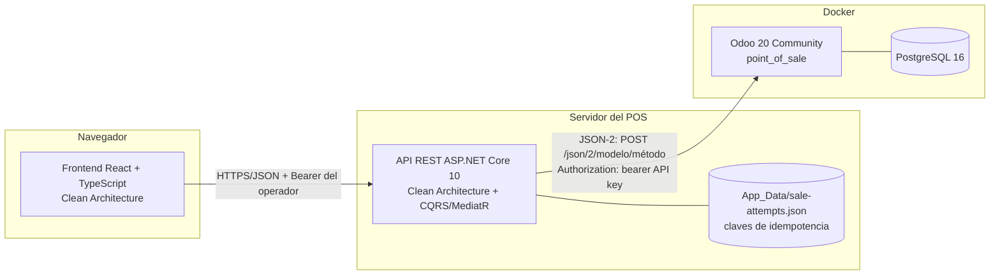
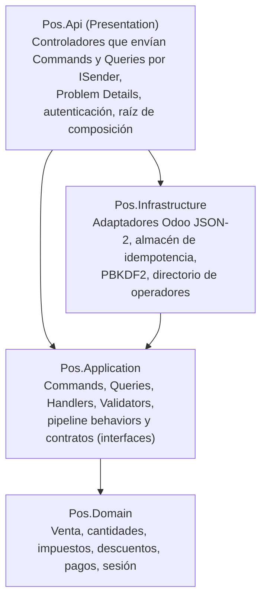
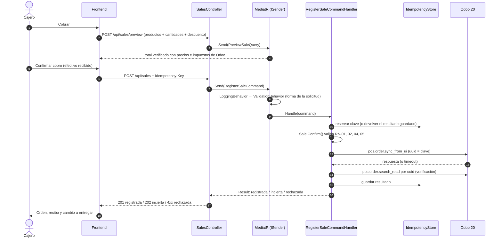

# Arquitectura

## Vista general

El navegador nunca habla con Odoo: todo pasa por la API .NET, que es la única que conoce la API key (RNF-09, sección 14).



Datos propios del POS (sección 3, "Persistencia"): solo los operadores con su rol (configuración) y los intentos de venta por clave de
idempotencia. Productos, precios, impuestos, sesiones, órdenes y pagos viven únicamente en Odoo.

## Capas del backend y dirección de dependencias

Las cuatro responsabilidades que pide el enunciado y que se trabajan en clase (Domain, Application, Infrastructure y Presentation) son
proyectos separados. En Visual Studio la solución `backend/PosOdoo.slnx` las agrupa en las carpetas **Core** (Domain y Application),
**Infrastructure**, **Presentation** y **Tests**.



| Proyecto | Responsabilidad | Depende de |
|---|---|---|
| `Pos.Domain` | Reglas de negocio puras: `Sale` (RN-01, 02, 05, 06), `Quantity`, `DiscountPercentage`, políticas de descuento, `TaxCalculator`, `Payment`, `PosSession`, `Result`/`Error`. | Nada (ni paquetes ni framework). |
| `Pos.Application` | Casos de uso escritos como **Commands y Queries con sus Handlers** (MediatR), sus **Validators** (FluentValidation), los **pipeline behaviors** (registro y validación) y los **contratos** que implementa Infrastructure (`IProductCatalog`, `IPosSessionGateway`, `IPosOrderGateway`, `IIdempotencyStore`...). | Domain, MediatR y FluentValidation. **No** conoce HTTP, ASP.NET Core ni Odoo. |
| `Pos.Infrastructure` | Implementa los contratos: cliente JSON-2, adaptadores de Odoo, almacén de idempotencia en archivo, hash PBKDF2. | Application (+ framework compartido de .NET). |
| `Pos.Api` | Presentation: traduce HTTP en Commands y Queries, los envía por `ISender`, autentica, convierte los errores a RFC 9457 y compone todo. | Application, Infrastructure. |

La regla de dependencia se puede comprobar en los `.csproj`: Domain no tiene referencias; Application solo referencia Domain y los dos
paquetes del taller (MediatR 14.2.0 y FluentValidation 12.2.0, versiones fijadas). Infrastructure y la API usan únicamente lo que trae .NET 10.

### Estructura de Application (como en las prácticas de clase)

```
Pos.Application/
├── Behaviors/                   LoggingBehavior, ValidationBehavior (pipeline de MediatR)
├── Common/                      OperatorIdentity, PagedResult, PageRequest, reglas de validación compartidas
├── Contracts/
│   ├── Gateways/                IProductCatalog, IPosSessionGateway, IPosOrderGateway (hacia Odoo)
│   ├── Persistence/             IIdempotencyStore (dato propio del POS)
│   └── Security/                IOperatorDirectory, IPasswordHasher
├── Features/
│   ├── Auth/Commands/Login/                     LoginCommand, Handler, Validator
│   ├── Catalog/Queries/SearchProducts/          SearchProductsQuery, Handler, Validator
│   ├── Catalog/Queries/GetProductCategories/    Query, Handler
│   ├── Sessions/Queries/GetActiveSession/       Query, Handler
│   ├── Discounts/Queries/GetDiscountPolicies/   Query, Handler (+ DiscountPolicyCatalog)
│   ├── Sales/Commands/RegisterSale/             RegisterSaleCommand, Handler, Validator
│   ├── Sales/Commands/VerifySaleAttempt/        Command, Handler, Validator
│   ├── Sales/Queries/PreviewSale/               PreviewSaleQuery, Handler, Validator
│   ├── Sales/                                   SaleComposer, SaleDraftValidator, SaleAttemptFactory, contratos de datos
│   ├── History/Queries/GetSalesHistory/         Query, Handler, Validator
│   └── History/Queries/GetSaleDetail/           Query, Handler, Validator
└── RegisterApplicationServices.cs               AddMediatR (escaneo, Scoped, behaviors) + AddValidatorsFromAssembly
```

Por qué CQRS con Mediator y no *Services* ni *UseCases*: decisión D8 en [DECISIONES_DISENO.md](DECISIONES_DISENO.md).

## Capas del frontend

```
frontend/src/
├── domain/          Reglas puras: carrito (P07), dinero y redondeo, impuestos, descuentos, validación del pago
├── application/     Casos de uso (una clase por operación con un solo método execute) y puertos:
│                    TicketStore (Observer), CheckoutProcess (ciclo de vida de la clave de idempotencia)
├── infrastructure/  fetch + Problem Details (ApiClient), adaptadores HTTP, sessionStorage, generador de UUID
├── presentation/    React: pantallas, componentes, contextos y estilos; createServices conecta casos de uso y puertos
└── main.tsx         Raíz de composición: el único lugar que conoce las implementaciones concretas
```

Ni `domain/` ni `application/` importan React o `fetch`; se prueban con Vitest en Node sin navegador.

## Flujo de una venta (RF-09 a RF-12)



Si el Validator rechaza la solicitud, `ValidationBehavior` devuelve el error sin llamar al Handler: no se reserva la clave ni se
consulta a Odoo.

## Endpoints de la API

| Método | Ruta | Command / Query | Propósito | Respuestas |
|---|---|---|---|---|
| POST | `/api/auth/login` | `LoginCommand` | Identificar al operador (token Bearer de ASP.NET Core, 8 h) | 200, 400, 401, 429 |
| GET | `/api/auth/me` | (lee el token) | Operador actual y rol | 200, 401 |
| GET | `/api/products?search=&categoryId=&onlyInStock=&sort=&page=&pageSize=` | `SearchProductsQuery` | Catálogo de Odoo (RF-01, RF-02) | 200, 400, 503 |
| GET | `/api/products/categories` | `GetProductCategoriesQuery` | Categorías del POS | 200 |
| GET | `/api/pos/sessions/active` | `GetActiveSessionQuery` | Sesión vigente, moneda, métodos de pago y si permite vender | 200, 422, 503 |
| GET | `/api/discounts/policies` | `GetDiscountPoliciesQuery` | Políticas habilitadas para el rol (RF-06) | 200 |
| POST | `/api/sales/preview` | `PreviewSaleQuery` | Total verificado sin registrar (RF-05) | 200, 400, 403, 422 |
| POST | `/api/sales` (encabezado `Idempotency-Key`) | `RegisterSaleCommand` | Registrar venta y pago (RF-09 a RF-12) | 201, 200 (repetición), 202 (incierta), 400, 403, 409, 422, 503 |
| GET | `/api/sales/attempts/{clave}` | `VerifySaleAttemptCommand` | Estado real de un intento (RF-17) | 200, 404 |
| GET | `/api/sales?search=&state=&from=&to=&page=` | `GetSalesHistoryQuery` | Historial (RF-13) | 200, 400 |
| GET | `/api/sales/{id}` | `GetSaleDetailQuery` | Detalle (RF-14) | 200, 404 |
| GET | `/api/health` | (health check) | Estado de la API y de Odoo (público) | 200, 503 |

La colección de Postman [docs/postman/POS-Odoo20.postman_collection.json](postman/POS-Odoo20.postman_collection.json) ejecuta todos estos
endpoints en orden y, en otra carpeta, consultas de solo lectura a Odoo JSON-2 para estudiar el ERP.

Todas las respuestas de error tienen la misma forma (RFC 9457), vengan del Validator, del dominio o de Odoo:

```json
{
  "type": "https://httpstatuses.io/422",
  "title": "La operación no cumple las reglas del negocio",
  "status": 422,
  "detail": "La sesión POS/00001 no está abierta (estado: cerrada). No se pueden registrar ventas.",
  "code": "SESSION.NOT_OPEN",
  "errors": [ { "code": "SESSION.NOT_OPEN", "message": "...", "target": "sessionId" } ],
  "traceId": "00-…"
}
```

## Seguridad (RNF-09)

- API key de Odoo solo en el backend: `dotnet user-secrets` (desarrollo) o variable de entorno `Odoo__ApiKey` (producción). Si falta,
  la API no arranca y explica cómo configurarla.
- Usuario de integración con permisos de **Usuario del POS** (no administrador) y API key con vencimiento (180 días).
- Operadores con contraseña en hash PBKDF2-SHA256 (210 000 iteraciones, sal aleatoria); el mensaje de error no revela si el usuario existe
  y el tiempo de respuesta tampoco.
- `LoggingBehavior` registra el nombre de cada solicitud, su duración y su resultado, nunca su contenido (no registra contraseñas).
- Límite de 10 intentos de inicio de sesión por minuto e IP; política de autorización por defecto "autenticado" en todos los endpoints.
- Validación de todas las entradas: forma en los Validators del pipeline, reglas en Domain; JSON mal formado responde 400 con el campo afectado.
- CORS restringido al origen del frontend; encabezados `X-Content-Type-Options`, `X-Frame-Options`, `Referrer-Policy`, `Cache-Control: no-store`.
- El token del operador se guarda en `sessionStorage` (se borra al cerrar la pestaña).
